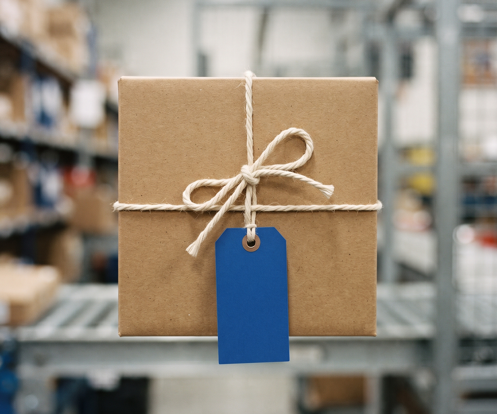

# apivuln-api-fuzzer-lite

# apivuln-API-Fuzzer-Lite
A spec driven fuzzer that sends random, type shaped values to the endpoints declared in a provided OpenAPI/Swagger specification (JSON). Generated values are substituted for path, query, and header parameters and for request bodies. When an operation declares a 200 response schema, the response body is checked against that schema with `jsonschema`, and a failed check is logged as a warning. The closing line of a run counts the requests attempted, succeeded, failed, and validated, and a run in which no request succeeded exits 1 (a `--dry-run` run sends nothing and is exempt). This tool does not test for injection flaws, broken authentication, or data exposure, and it does not validate requests against the schema.

## Install

> Field note, pinned to the bench: the clone line above names the ShadowStrikeHQ account, while this repository lives under ShadowGuard-AI. The line is kept as written.

`git clone https://github.com/ShadowStrikeHQ/apivuln-api-fuzzer-lite`

## Usage

> Field note, pinned to the bench: the usage line names no specification argument, even though the tool runs from a provided OpenAPI or Swagger specification. No flag is invented here to fill that gap.

`./apivuln-api-fuzzer-lite [params]`

## Parameters

> Field note, pinned to the bench: a dry run sends nothing and is exempt from the exit 1 rule that ends a run in which no request succeeded.

- `-h`: Show help message and exit
- `--requests`: Number of requests to send per endpoint. Defaults to 10.
- `--dry-run`: Perform a dry run without sending actual requests.

## License
Copyright (c) ShadowStrikeHQ
